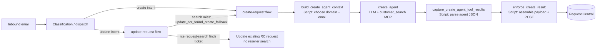
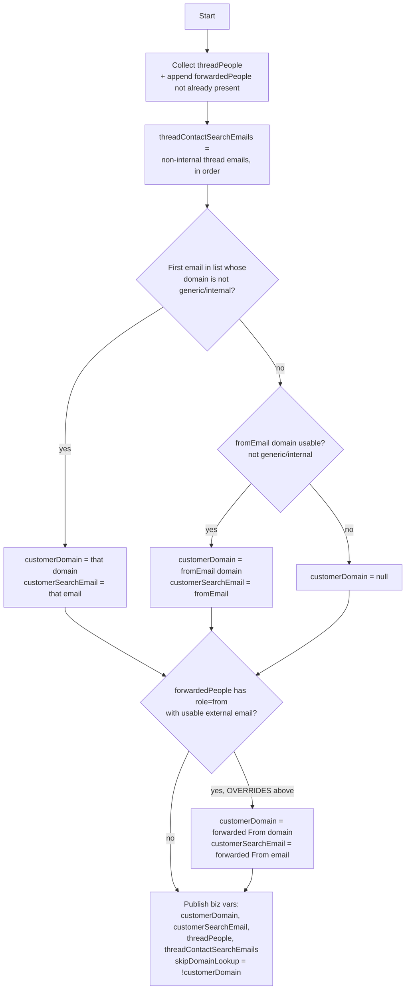
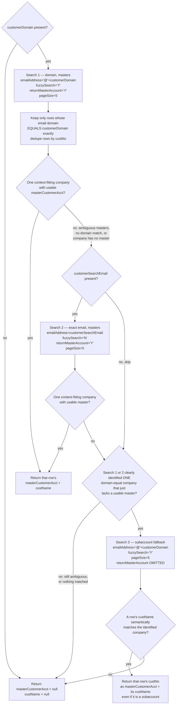
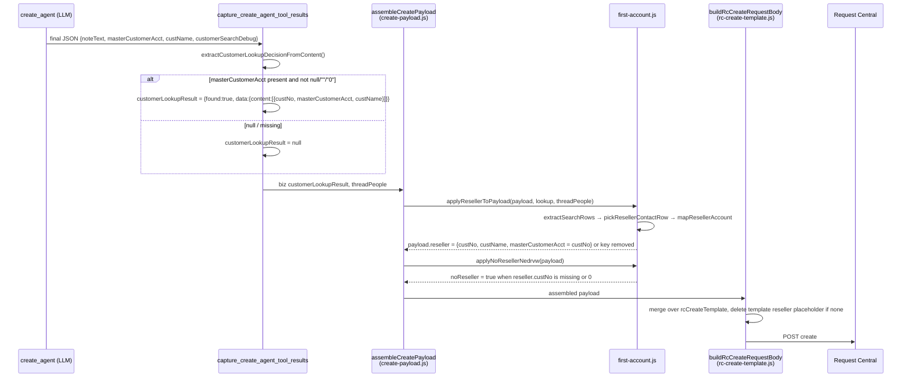
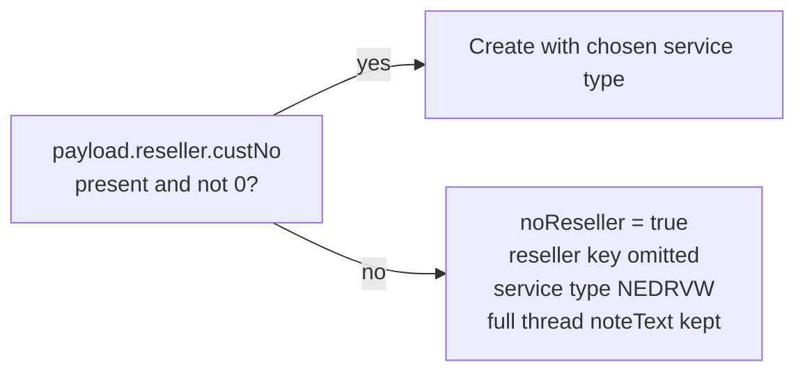
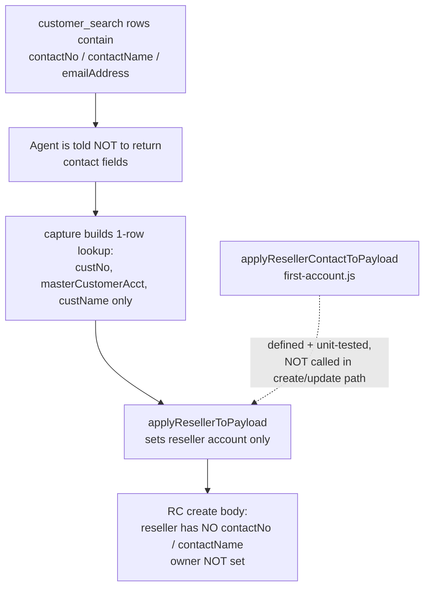
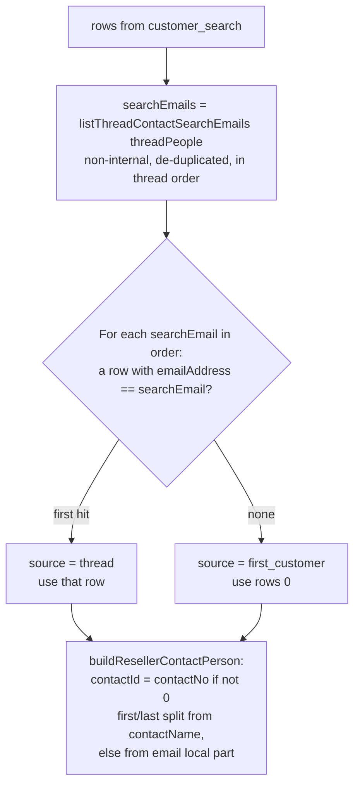

# SOP: Reseller & Reseller Contact Search

Branch: `42-reseller-contact` (as of commit `364dedf`, "fix: reseller third search and assigned to fixes").

This document describes how the pipeline decides which **reseller account** (and reseller contact) goes on a Request Central (RC) create request, step by step, with the source file for each step.

## TL;DR

1. A **Script** node (`build_create_agent_context`) picks **one** `customerDomain` and **one** `customerSearchEmail` from the email thread.
2. The **create agent** calls MDM `customer_search` up to **three** times:
   3. `@domain` fuzzy search, master accounts only
   4. exact `customerSearchEmail` search, master accounts only
   5. `@domain` fuzzy search **without** `returnMasterAccount` (subaccount fallback)
6. The agent returns `masterCustomerAcct` + `custName` (or `null`) in its final JSON.
7. A **Script** node (`capture_create_agent_tool_results`) turns that answer into a one-row `customerLookupResult`.
8. `assembleCreatePayload` maps it onto `payload.reseller`. If there is no reseller, the request is created with service type `NEDRVW` (needs review).
9. The update flow **never** calls `customer_search`. When an update can't find its ticket it hands off to the create flow, which runs the search described here.

## 1. Where this sits in the pipeline



| Stage | File |
|---|---|
| Domain / email selection | `src/spec-06/shared/node-glue/build_create_agent_context.glue.js` (bundled into `src/spec-06/create-request/handoff/handoff_ok/ifCondition/build_create_agent_context.js`) |
| Agent prompt | `src/spec-06/create-request/handoff/handoff_ok/ifCondition/create_agent/prompts.md` + `systemContent` in the glue above |
| Capture agent answer | `src/spec-06/shared/lib/capture-agent-tool-results.js`, `src/spec-06/shared/node-glue/capture_create_agent_tool_results.glue.js` |
| Reseller mapping helpers | `src/spec-06/shared/lib/first-account.js` |
| Payload assembly | `src/spec-06/shared/lib/create-payload.js` (`assembleCreatePayload`) |
| RC body build + POST | `src/spec-06/shared/lib/rc-create-template.js` (`buildRcCreateRequestBody`), `src/spec-06/shared/node-glue/enforce_create_result.glue.js` |

> The bundled node files (`build_create_agent_context.js`, `enforce_create_result.js`, `build_update_agent_context.js`, `enforce_update_result.js`) each have their own **copy** of the `first-account.js` helpers. Edit the shared lib, then re-bundle.

## 2. Step 1: choosing `customerDomain` and `customerSearchEmail` (Script, deterministic)

All of this runs in `build_create_agent_context.glue.js` before the agent sees anything.

### Filters (`first-account.js`)

| List | Domains | Effect |
|---|---|---|
| `GENERIC_DOMAINS` | `gmail.com`, `yahoo.com`, `outlook.com`, `hotmail.com` | Never used as `customerDomain` |
| `INTERNAL_DOMAINS` | `tdsynnex.com`, `synnex.com`, `techdata.com`, `cisco.com` | Never used as `customerDomain`. Emails from these domains are also dropped from `threadContactSearchEmails` |

`listThreadContactSearchEmails(threadPeople)` returns the lowercased, de-duplicated, **non-internal** emails in thread order. Generic-domain emails such as Gmail are kept in this list but skipped when picking a domain.

### Precedence



Rules that follow from this:

- **A forwarded `From:` always wins** when it is external and not on a generic domain. If several forwarded people have `role=from`, the **last** one in the loop wins.
- Otherwise the **first non-internal, non-generic thread person** wins.
- Otherwise the envelope `fromEmail` is used, provided it is not generic or internal.
- When `customerDomain` is null the agent is told `skipDomainLookup: true` and makes **no** searches. The request then has no reseller and gets `NEDRVW`.

## 3. Step 2: the agent's `customer_search` sequence (LLM)

The create agent only has the MDM `customer_search` tool (on `externalCustomerMcpServer`, default `customer-search-mcp`). It must make **one tool call per turn** and **at most three** customer searches.



### Search parameters

| # | When | `emailAddress` | `fuzzySearch` | `returnMasterAccount` | `pageSize` |
|---|---|---|---|---|---|
| 1 | Always, if `customerDomain` is set | `@` + `customerDomain` (e.g. `@datacomm.com`) | `Y` | `Y` | 5 |
| 2 | Search 1 didn't resolve to a single master **and** `customerSearchEmail` is set | `customerSearchEmail` (exact) | `N` | `Y` | 5 |
| 3 | Exactly one domain-equal company was identified but it has no usable master | `@` + `customerDomain` | `Y` | *omitted* (never `"N"`) | 5 |

### Why the leading `@`

Fuzzy email search matches on "contains". A bare `datacomm.com` would also match `easterndatacomm.com`. Even with the `@`, the agent must check that the row's email domain is **exactly** `customerDomain`.

### Selection rules given to the agent

- Pick the single company that best fits the domain, sender, thread content and business context.
- Never pick the **first row** by default.
- Never pick a row just because it has a `MASTER CUSTOMER` terms label.
- Never pick a row on a **contact-email match alone**. A matching email only supports a choice.
- Rows with the same `custNo` are duplicate contacts for one company, not competing candidates.
- Several rows pointing at the same master account do **not** make the result ambiguous.
- Use only `customerSearchEmail` for search 2. Never another thread email, and never the internal sender.
- The subaccount fallback (search 3) must **never** be used to break a tie between companies.
- Never select an unrelated account. When unsure, return `null`.

### Agent output contract

```json
{
  "noteText": "summary...\nPeople: Name <email>, ...",
  "masterCustomerAcct": 123456,
  "custName": "DATACOMM INC",
  "customerSearchDebug": [
    { "custNo": 123456, "custName": "DATACOMM INC", "emailAddress": "a@datacomm.com", "masterCustomerAcct": 123456 }
  ]
}
```

- For a master result, `masterCustomerAcct` is copied from the chosen row. For a search-3 fallback, it holds that row's **`custNo`**.
- `custName` comes from the **same** row.
- `customerSearchDebug` holds up to 5 rows from the search that produced the answer, with only those four fields (`[]` when there were no rows). It is used for logs and review only.
- The agent must **not** return `contactNo`, `contactName`, `contactEmail`, `masterCustomerName`, or any request-structure fields.

## 4. Step 3: from agent answer to `payload.reseller` (Script, deterministic)



Details:

- **The tool output is not used to pick the reseller.** On create, `customerLookupResult` is built **only from the agent's final JSON** (`extractCustomerLookupDecisionFromContent`). The raw `customer_search` responses are not re-read. That means the result is always one synthesized row.
- `pickResellerContactRow(rows, threadPeople)` prefers the row whose email matches a non-internal thread email, and otherwise takes the first row. With the single synthesized row, it always returns that row.
- `mapResellerAccount(row)` returns `undefined` when `masterCustomerAcct` is empty or `0`. Otherwise it sets `custNo = masterCustomerAcct` and copies any address, territory and sales fields present on the row.
- `applyResellerToPayload` then sets `reseller.masterCustomerAcct = reseller.custNo`, because RC derives the VSR from `masterCustomerAcct`, including for a subaccount fallback.
- The template placeholder `reseller` block (`'<from customer_search ...>'`) is deleted by `buildRcCreateRequestBody` when the assembled payload has no reseller. Placeholder strings are never sent to RC.

### No reseller → `NEDRVW`



## 5. Reseller contact: what happens today



**There is a gap on this branch.** The reseller contact is **not** written onto created requests:

- `applyResellerContactToPayload` (in `first-account.js`) can do it. It picks the MDM row whose email matches a non-internal thread email, or else the first row, then sets `reseller.contactNo` and `reseller.contactName` and deletes `owner` so RC can auto-assign. But it is only called from `tests/unit/spec-06/first-account.test.js`.
- Even if it were wired in, the create-path `customerLookupResult` only has `custNo`, `masterCustomerAcct` and `custName`. There are no `contactNo` or `emailAddress` fields to match on.
- `docs/reseller-contact.md` suggests putting the external contact in `owner`. The current helper comment says the opposite: "Reseller contacts belong on reseller; leave owner unset for RC auto-assignment."

To populate the contact, one of these is needed:

1. Have the agent return `contactNo`, `contactName` and `emailAddress` from the chosen row, and carry them in the synthesized lookup row. **Or** build `customerLookupResult` from the raw `customer_search` rows filtered to the chosen `custNo`.
2. Call `applyResellerContactToPayload(payload, customerLookupResult, threadPeople)` in `assembleCreatePayload` right after `applyResellerToPayload`.
3. Decide between `reseller.contactNo` and `owner` (see the open question in `docs/reseller-contact.md`).

### Contact row selection logic (`pickResellerContactRow`), for when it's wired in



## 6. Update flow

- The update agent (`update_agent/prompts.md`) is told not to call `customer_search` or `rcs-request-create`. If every request search is empty it stops, and a later node forwards to the create agent with `decisionReason = update_not_found_create_fallback`. Sections 2–5 then apply unchanged, and noteText starts with "Originally treated as an update request…".
- `rc_search_request.js` uses an explicit `resellerNo`/`customerNo` from identifiers or entities **only as a request-search argument**. It does not use it to set the reseller on a request.
- `capture_update_agent_tool_results` does harvest a raw `customer_search` result (`pickCustomerLookupResult`: the last invocation that has a non-zero `custNo`/`masterCustomerAcct`). In normal operation there isn't one, because the update agent doesn't search.

## 7. Debugging checklist

| Symptom | Check |
|---|---|
| No reseller and request is `NEDRVW` | Log `build-create-agent-context: ... skipDomainLookup=... customerDomain=...`. If `customerDomain=<missing>`, every thread email was internal or generic. |
| Wrong company chosen | Look at `customerSearchDebug` biz var for the rows the agent saw. Check whether the email domain is exact or only contains the target (e.g. `easterndatacomm.com`). |
| Searched the wrong domain | Check `forwardedPeople`. A forwarded external `From:` overrides thread order. |
| Subaccount used instead of master | That is expected only after search 3. Confirm searches 1 and 2 returned no usable master for that company. |
| More than 3 searches or parallel calls | Prompt violation. Check the agent's tool-call history in `createAgentOutput.toolCalls`. |
| Reseller contact missing | Expected on this branch. See section 5. |
| Reseller logged but not on request | Log `enforce-create-result: ... contactNo=...`. The `loggedReseller` fallback re-resolves from `customerLookupResult` only for logging. |

## 8. Related docs

- `docs/reseller-contact.md`: issue description for applying the reseller contact / owner
- `docs/issues/update-agent-cases/reseller-search-by-email-address.md`: why search 2 (exact email) exists
- `docs/reduce-search-queries.md`
- `src/spec-06/create-request/handoff/handoff_ok/ifCondition/create_agent/README.md`
