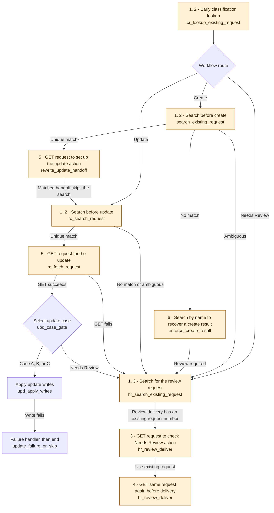

---
tags:
  - daily
date: 2026-11-18
---

# Daily Note

## Meets

## TODO

- [ ] Remove MCP - do what Varshil is doing - then work on MCP later
## Notes

## Plan to reduce Request Central searches

Reuse Request Central search results and full request GET responses within the same workflow run. Keep distinct identifier and `SECURITY WARNING:` searches that can find a different ticket. The [checked-in Dev Studio workflow](../src/devstudio.json) is the baseline for the map below.

### Where the calls repeat

Read the arrows from top to bottom. Highlighted steps show where repeated or avoidable calls occur. The numbers match the fixes below. Some gates are omitted to make the call paths easier to follow.

| #   | Where the extra call occurs                                                                                                                                                       | Can remove without a major refactor?                                                                                                                                                                  |
| --- | --------------------------------------------------------------------------------------------------------------------------------------------------------------------------------- | ----------------------------------------------------------------------------------------------------------------------------------------------------------------------------------------------------- |
| 1   | The early classification lookup runs, then pre-create, update, or Needs Review issues the same RC query.                                                                          | **Yes.** Reuse completed responses for identical queries. Each branch applies its own matching rules and can run additional queries.                                                                  |
| 2   | The update gate combines overlapping attempt lists. Extracted names and subjects can normalize to the same query, and detail hydration can repeat an exact request-number search. | **Yes.** Deduplicate by the outbound RC request body. Keep follow-up queries with different inputs or scope.                                                                                          |
| 3   | Needs Review looks up a ticket already verified on the update path, then reads its action state.                                                                                  | **Yes.** Pass the verified request number and full GET payload through Biz Vars. Skip discovery for that ticket. If the GET failed, retry the detail GET by number.                                   |
| 4   | The Needs Review create check and delivery step inspect the same existing ticket in `hr_review_deliver`.                                                                          | **Yes.** Reuse the first GET response, including when it contains no Needs Review action. Keep the fresh read for a newly created review request when its action number is missing.                   |
| 5   | The create-to-update rewrite fetches the ticket for action setup, and update entry can fetch it again.                                                                            | **Yes, for the repeated GET.** Pass a same-ticket snapshot through the handoff while its action state is current. Keep polling after a status write when the workflow needs to discover a new action. |
| 6   | Create-result recovery can search by name even when a successful create response already supplies the request number.                                                             | **Yes.** Use the valid number from the create response. Keep the recovery search when the number is missing and the create may have succeeded.                                                        |

### Implementation

- Put the pre-write search cache in the shared RC search code. Use one standard search window per run and key entries by the normalized outbound body, including dates and scope. Reuse successful responses, including genuine misses and ambiguous results. Retry failed calls where the workflow already would. Keep create recovery and post-write polling outside this cache.
- Extend the existing `fetchedRequest` Biz Var handoff to bind the full GET payload to its verified request number. Reuse it for the same ticket while its action state is current. A completed Needs Review action still triggers a new review request.
- Keep current failure routing. Update handoff, fetch, and case-selection failures can reach Needs Review delivery. Write failures end through `update_failure_or_skip` in the checked-in export.
- Edit the source scripts, regenerate the affected Nashorn bundles, and sync the Dev Studio export. Update the existing create-result test to expect recovery searches only when a trusted request number is missing.

### Verification

- Count RC search POSTs and detail GETs in mocked workflow runs for create after a miss, direct update, create-to-update, and Needs Review after a verified match. Verify that each identical pre-write query runs once and measure those routes against the reported nine-query allowance.
- Exercise distinct security-title searches, ambiguous results, a transient search failure, a completed Needs Review action, and post-write action polling. Verify ticket selection, delivery, and retry behavior.
- Run the focused suites and the Nashorn scan on the regenerated export. The baseline is 43 of 44 focused checks passing. The existing [search-gate assertion](../tests/unit/spec-06/search-gate.test.js) expects unscoped arguments, while the implementation includes vendor and brand scope.

# Cisco Request Central business update

Updated November 18, 2026

| Status     | Business update                                                                                                                                                                                                                            |
| ---------- | ------------------------------------------------------------------------------------------------------------------------------------------------------------------------------------------------------------------------------------------ |
| Backlog    | Reduce repeat Request Central lookups to lower system load.                                                                                                                                                                                |
| Backlog    | Route emails that exhaust retries to IDP Failed.                                                                                                                                                                                           |
| Backlog    | Prevent unmatched ECExpress notifications from opening tickets.                                                                                                                                                                            |
| In UAT     | **Cisco PO processing.** New PO information in an email or attachment can start processing after a request is created or updated. A failed handoff adds a note for manual follow-up. Merged November 12. End-to-end validation is pending. |
| In PROD    | **Request matching.** Existing-request searches are scoped to Cisco. Merged November 12.                                                                                                                                                   |
| In Dev/UAT | **Reseller contacts.** New requests match reseller accounts by email or company domain and use the external contact as the request owner.                                                                                                  |
| In UAT     | **Request updates.** Follow-ups select the appropriate open action, preserve its assignee, or create a new action when all prior actions are closed.                                                                                       |
| In UAT     | **Manual review.** Review notes tell staff what to check before processing a request.                                                                                                                                                      |
| In UAT     | **Attachments.** Long filenames are shortened so files can be attached.                                                                                                                                                                    |

<!--
For each update, refresh the date and revise existing rows in place. Keep one row per business outcome. Use Backlog for planned work, In Dev for work underway or awaiting UAT, UAT when testing there is confirmed, and Prod when production deployment is confirmed. Briefly describe the change and add a blocker or next milestone when relevant.
Baseline sources are PR #44 (40-po-processing-integration), specs/019-po-processing-integration/tasks.md, the commits ahead of main and working changes on 42-reseller-contact, docs/business-search.md, and docs/issues/update-agent-cases/main.md.
-->
